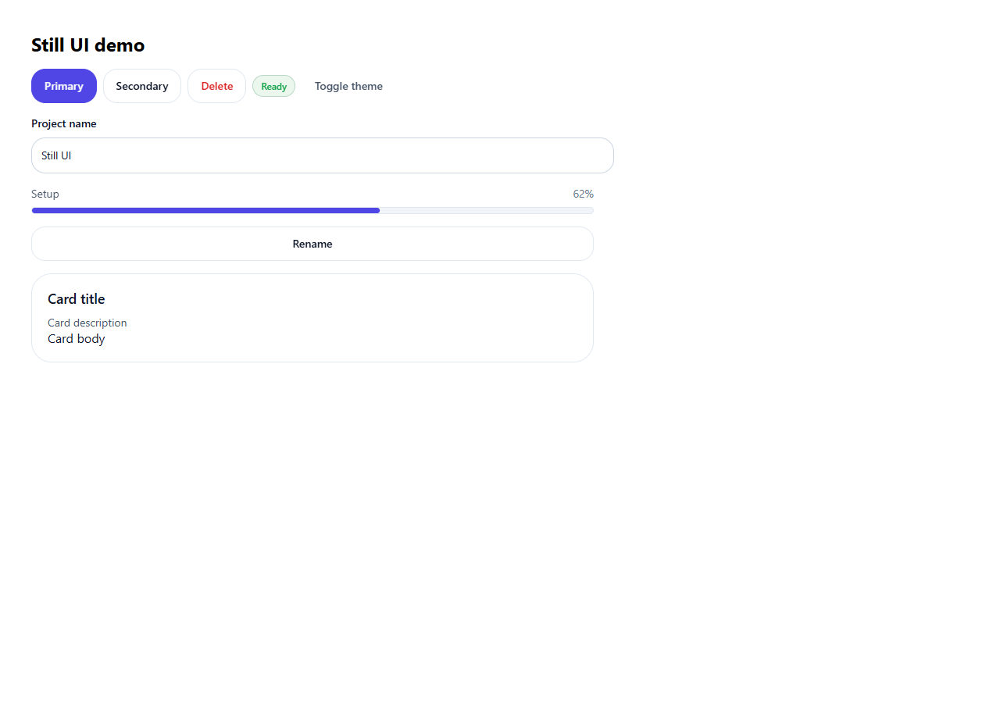
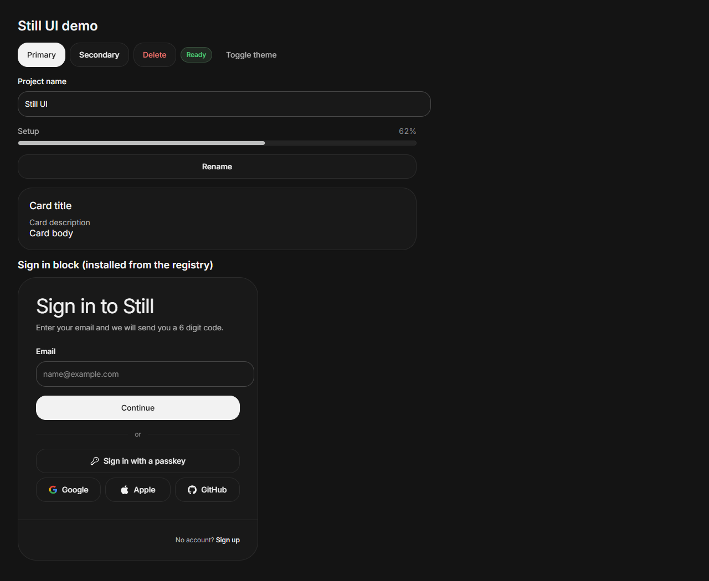

# Still UI

[English](./README.md) | 简体中文

带克制动效的个人 React 组件库。源码归你所有：基于语义设计令牌的 CSS Modules、用 [Motion](https://motion.dev) 做动画、完整的键盘操作，以及每个组件都有的 reduced-motion 分支。组件以普通源码文件的形式装进你的项目，没有需要保持同步的运行时包。

本仓库 fork 自 [Arc Library](https://github.com/kuratlielia/arc-library)（MIT），保留 [uiarc.dev](https://uiarc.dev) 的原始视觉语言：中性色板、Geist/Inter 字体、柔和同心圆角、克制的弹簧动效。仓库包含完整的免费版本：**116 个组件 + 22 个区块**，以及它们共用的设计与动效令牌。





## 安装

在项目的 `components.json` 里注册一次注册表：

```json
{
  "registries": {
    "@still": "https://raw.githubusercontent.com/gyb-cpu/still-ui/main/public/r/{name}.json"
  }
}
```

每个项目安装一次设计令牌，然后按需安装组件或区块：

```bash
npx shadcn@latest add @still/still-foundation
npx shadcn@latest add @still/button @still/input @still/dialog
npx shadcn@latest add @still/command-palette   # 区块
```

也可以不改 `components.json`，直接用完整 URL 安装：

```bash
npx shadcn@latest add https://raw.githubusercontent.com/gyb-cpu/still-ui/main/public/r/button.json
```

在应用入口导入令牌：

```tsx
// app/layout.tsx（Next.js）或 src/main.tsx（Vite）
import "@/components/still/foundation.css";
```

```tsx
import { Button } from "@/components/still/button/button";

export function SaveBar() {
  return <Button variant="primary">保存修改</Button>;
}
```

文件会落在 `components/still/<id>/…`（`src/` 结构下是 `src/components/still/…`），组件之间用相对路径互相引用。区块内部用到的组件等本地依赖会自动带出。

环境要求：React 19 + TypeScript、Next.js（App Router）或 Vite、`@/*` 导入别名，以及 `motion`。部分组件还会用到 `lucide-react` 或 Radix 原语，CLI 会自动安装对应依赖。不需要 Tailwind。

## 字体

令牌搭配 Geist（标题）与 Inter（正文），与上游站点一致。加载一次字体即可；没有加载时字体会回退到系统 sans-serif。

```tsx
// app/layout.tsx — Next.js
import { Geist, Inter } from "next/font/google";
const geist = Geist({ subsets: ["latin"], variable: "--font-geist" });
const inter = Inter({ subsets: ["latin"], variable: "--font-inter" });

export default function RootLayout({ children }: { children: React.ReactNode }) {
  return (
    <html lang="en" className={`${geist.variable} ${inter.variable}`}>
      <body>{children}</body>
    </html>
  );
}
```

Vite 或普通 React 项目可以用 `@font-face` 或 `<link>` 加载这两套字体，并在 `:root` 上设置 `--font-geist` / `--font-inter`。中文优先的项目建议在 `foundation.css` 的 `--font-body` 末尾追加 `"PingFang SC", "Microsoft YaHei"`。

## 版本与固定版本

`main` 跟踪最新源码；稳定快照通过 tag 发布。把注册表地址固定到 tag，安装结果才可复现：

```json
{
  "registries": {
    "@still": "https://raw.githubusercontent.com/gyb-cpu/still-ui/v0.1.0/public/r/{name}.json"
  }
}
```

`v0.1.0` 是全量首版（116 组件 + 22 区块、Arc 原始视觉语言、Still 品牌文案）。升级时改 tag、重新执行 `npx shadcn@latest add … --overwrite`，再检查 diff。tag 按语义化版本递增，两次发布之间 `main` 可能已经前进。

## 主题

组件只读语义令牌，不直接使用原始颜色。改一次 `foundation.css` 里的调色板，所有组件在亮暗两种主题下都会跟随变化。

- **暗色模式**：在 `<html>` 上设置 `data-theme="dark"`。
- **强调色**：在 `<html>` 上设置 `data-accent` 为 `neutral`、`violet`、`blue`、`green`、`amber`、`orange`、`coral` 或 `rose`。
- **默认风格**：中性表面、墨色主操作、柔和阴影、弹簧动效。可在 `registry/foundation.css` 中调整 `--accent`、`--surface*`、`--border*`、`--radius-*`、`--font-body`、`--shadow-*`。
- **动效**：预设位于 `registry/motion-tokens.ts`；所有动画都遵守 `prefers-reduced-motion`。

## 组件与区块

116 个组件、22 个区块，与上游站点的分类一致：

- **操作（Actions）**：按钮、手势、菜单、主题切换
- **输入（Inputs）**：文本输入、特殊输入、选择器、开关、滑块、日期/颜色选择、编辑器
- **披露（Disclosure）**：导航、展开、浮层
- **反馈（Feedback）**：消息、进度
- **数据（Data）**：头像、卡片、图表、表格、动态、媒体
- **文本（Text）**：文字效果
- **特殊（Special）**：槽位滚动文字
- **区块（Blocks）**：应用外壳、登录注册、定价、媒体、Hero、特性、社会证明、内容、页头页脚

每个条目在 [`docs/`](./docs) 下都有一页文档，包含安装命令、文件清单、导出和示例。`llms.txt` 是给编码代理用的扁平索引。

区块使用 Still 品牌名；上线前请替换示例邮箱、链接和远程示例图片。

## 面向 AI 编码代理

- [`SKILL.md`](./SKILL.md)：如何选择、安装、组合和验证 Still 组件。
- [`AGENTS.md`](./AGENTS.md)：可粘贴到项目代理指令里的简短常驻规则。
- [`llms.txt`](./llms.txt)：一行一个条目的索引。
- [`docs/`](./docs)：逐组件文档页。

## 仓库结构

```text
registry/foundation.css        设计令牌，亮色与暗色主题
registry/motion-tokens.ts      动效预设
lib/motion-tokens.ts           动效预设，共用导入路径
lib/still-provider.tsx         替换 link/image 元素（Next.js、路由）
lib/media.ts                   营销区块使用的示例媒体
registry/components/<id>/      组件
registry/blocks/<id>/          营销区块
registry.json                  注册表索引（140 个条目）
public/r/<id>.json             预构建的注册表条目，供 shadcn CLI 使用
docs/<id>.md                   生成的逐组件文档
scripts/build-registry.mjs     从源码重新生成 public/r
scripts/build-docs.mjs         重新生成 docs/ 与 llms.txt
```

## 开发

```bash
npm install
npm run build          # 重新生成 public/r、docs/ 和 llms.txt
npm run check          # typecheck + lint + 注册表一致性校验
```

要从上游补充条目：复制 `registry/components/` 或 `registry/blocks/` 下的目录，在 `registry.json` 增加对应条目（files、dependencies、`registryDependencies`），执行 `npm run build`，再执行 `npm run check`。同步策略见 [UPSTREAM.md](./UPSTREAM.md)。

## 验证

2026-10-22 执行的检查见 [VERIFICATION.md](./VERIFICATION.md)：`npm run check`、一次全量安装模拟、以及从 raw 注册表用真实 `shadcn add` 安装后执行的类型检查与生产构建。

## 许可

MIT。Arc Library 原始版权 © 2026 Elia Kuratli；修改部分 © 2026 gyb-cpu。详见 [LICENSE](./LICENSE)。不包含 Arc Pro 内容，Arc Pro 也未授权再分发。
